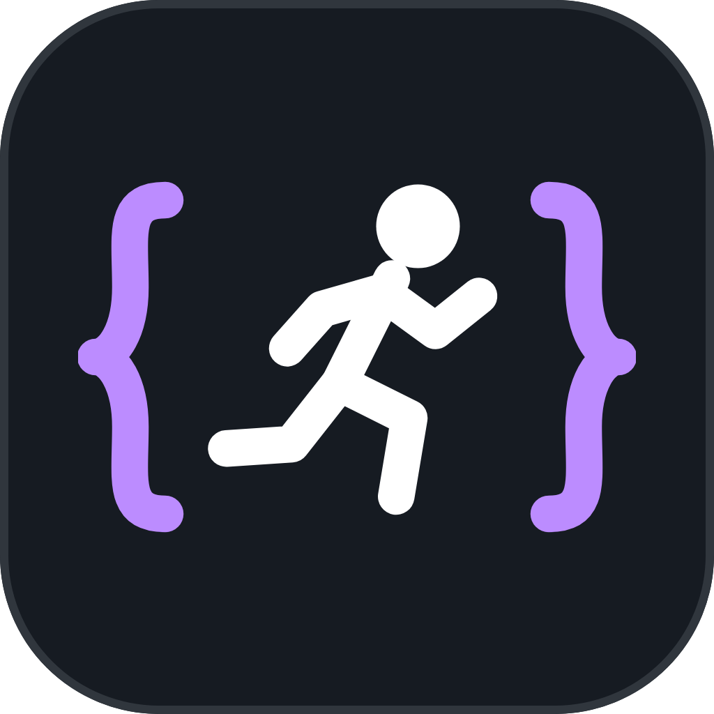
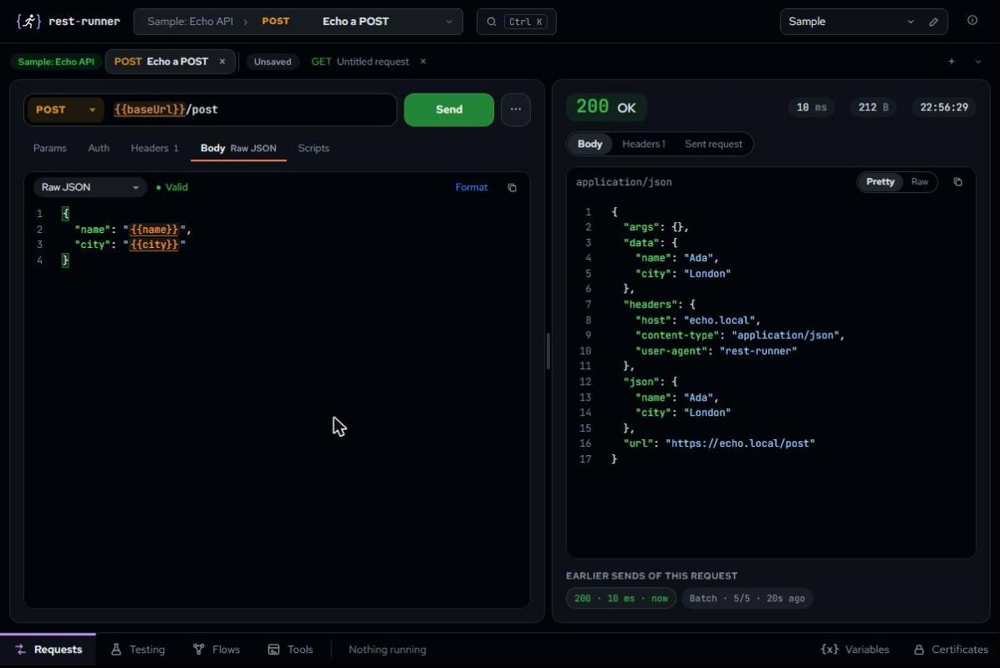
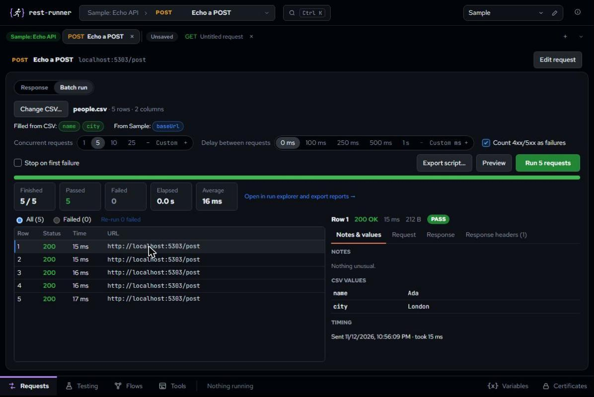
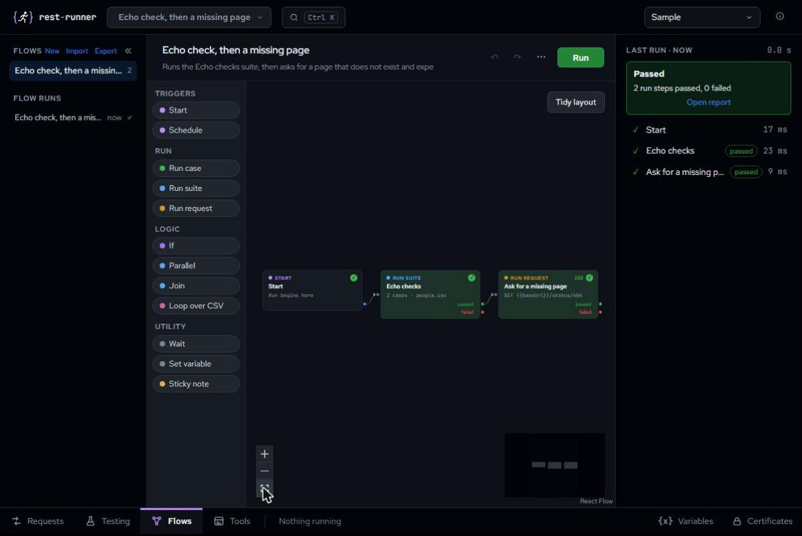

<p align="center"></p>
<h1 align="center">REST Runner</h1>
<p align="center">Send a request. Send it for every row of a CSV. Test it. Chain it.<br>A lightweight, local desktop app for macOS and Windows.</p>

<p align="center">
  <a href="#get-it">Get it</a> ·
  <a href="docs/README.md">User guide</a> ·
  <a href="docs/getting-started.md">Getting started</a> ·
  <a href="docs/shortcuts.md">Shortcuts</a>
</p>

<!-- TODO: screenshot of the Requests screen (request left, response right)
     <p align="center"></p> -->

## One app, four jobs

### Requests
Build a request with params, headers, auth and a JSON body, with `{{placeholders}}`, and read the response next to it, including the exact request that was sent. Keep requests in collections and folders, open several as tabs, import a cURL command or a Postman collection.

### Batch runs from a CSV
Write the request once with `{{column}}` placeholders, pick a CSV, choose how many run at once and how long to pause, and results stream in as they arrive. Export an HTML or CSV report, or a Python/Bash script to run it without the app.

<!-- TODO: screenshot of a batch run in progress
     <p align="center"></p> -->

### Test suites
Ordered test cases with no-code assertions (status, time, headers, JSON paths) and optional JavaScript scripts using the `rr` API. A suite can run once per CSV row.

### Flows
Chain cases, suites and saved requests on a canvas with branches, loops, retries and schedules.

<!-- TODO: screenshot of the Flows canvas
     <p align="center"></p> -->

## Local by design

- No account, no sync, no telemetry banners. Your data lives on your computer.
- Requests are sent from the Rust side, so browser CORS rules do not apply.
- Secret variables are kept in the macOS Keychain or Windows Credential Manager and masked on screen and in reports.
- Works offline; fonts are bundled.
- Environments can be coloured; Prod-style ones turn Send red.

## Get it

Every push builds installers in GitHub Actions. Open the latest run on the **Actions** tab and download `rest-runner-macos-universal` (a `.dmg`) or `rest-runner-windows-x64` (an `.msi` and a setup `.exe`).

Builds are not signed with a paid certificate yet:

- **macOS:** right-click the app and choose **Open**. If macOS says it is damaged, run `xattr -cr "/Applications/REST Runner.app"` once.
- **Windows:** on the SmartScreen prompt, click **More info**, then **Run anyway**.

Updating is manual and never automatic; see [Updating](docs/getting-started.md#updating-rest-runner).

## Build from source

```sh
npm install
npm run tauri dev     # run with hot reload
npm test              # unit tests
npm run tauri build   # installer for the current OS
```

Needs Node 22+ and Rust (stable). On Windows also install the WebView2 runtime (already on Windows 11) and the Visual Studio C++ build tools; see the [Tauri prerequisites](https://tauri.app/start/prerequisites/). `npm run dev` runs the UI alone in a browser, which is handy for layout work, but requests there go through the browser, so CORS rules apply. Built with Tauri 2, React and TypeScript. Maintainers: [docs/releasing.md](docs/releasing.md).

### Project layout

```
src/                 React UI
  components/        Editors and panes
  lib/               Request building, templates, sending (no UI code)
src-tauri/           Rust shell, app config, icons, permissions
brand/               Logo and app icon sources (see BRAND.md)
docs/                User guide (start at docs/README.md)
.github/workflows/   Test and build pipeline
```
